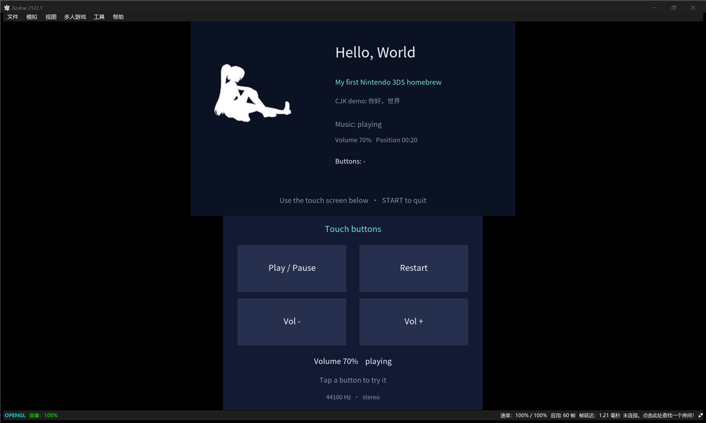

# hello-3ds

A small Nintendo 3DS homebrew example. Every non-obvious line is commented, and the tricky
parts (asset pipelines, the NDSP audio thread) are explained in place rather than left as magic.

Built with assistance from Pi Agent + DeepSeek V4 flash.



> **Note on comments:** the source comments are written in Chinese, because this repo started
> as a personal learning project. The code itself is plain C and the identifiers/UI are English,
> so it should still be readable. A Chinese walkthrough is in [`README.zh-CN.md`](README.zh-CN.md).

---

## What it demonstrates

| # | Feature | Key APIs |
|---|---------|----------|
| 1 | Text on **both screens** | `C2D_TextBufNew` / `C2D_TextFontParse` / `C2D_DrawText` |
| 2 | A PNG image, converted at build time | `tex3ds` → `.t3x` → `C2D_SpriteSheetLoad` |
| 3 | **Touch-screen buttons** on the bottom screen | `hidTouchRead` + rectangle hit-testing |
| 4 | **Streaming MP3 background music**, looped | `minimp3` + `NDSP` wave buffers on a worker thread |
| 5 | **CJK text rendering** | `mkbcfnt` font subset packed into romfs |

Each of those is a thing people routinely get stuck on, so they are deliberately kept
small and separate.

---

## Requirements

* [devkitPro](https://devkitpro.org/wiki/Getting_Started) with the `3ds-dev` package group
  (provides `devkitARM`, `libctru`, `citro3d`, `citro2d`, `tex3ds`, `mkbcfnt`, …).
* An emulator (**[Azahar](https://azahar-emu.org/)** — the maintained successor to Citra) or a
  real 3DS.

Verify your toolchain with:

```sh
echo $DEVKITPRO     # should be /opt/devkitpro  (C:\devkitPro on Windows)
arm-none-eabi-gcc --version
```

---

## Build

```sh
make          # produces hello-3ds.3dsx
make clean
```

The output name follows the folder name, so keep the folder named `hello-3ds`.

---

## Run

- **Emulator** — open `hello-3ds.3dsx` in [Azahar](https://azahar-emu.org/) (File → Load File).
- **Hardware** — copy it to `SD:/3ds/` and open it with the homebrew launcher on the device.
- **Audio** — playback needs a DSP firmware file at `sdmc:/3ds/dspfirm.cdc`. Each user supplies
  their own; it is not distributed with this project and must never be committed. Without it the
  app still runs, it just shows `Audio unavailable: …` and stays silent.

---

## Project layout

```
hello-3ds/
├── source/main.c              the whole program (~840 lines, heavily commented)
├── source/minimp3.h           MP3 decoder, single-header, CC0 (vendored)
├── Makefile                   standard devkitPro 3DS makefile
├── icon.png                   48x48 app icon, shown by the Homebrew Launcher
├── gfx/
│   ├── logo.png               source image (white silhouette on transparent)
│   ├── logo.t3s               tex3ds recipe
│   └── whitelist.txt          codepoints to include in the font subset
├── romfs/                     everything here gets packed into the .3dsx
│   ├── cjk.bcfnt              CJK font subset
│   ├── gfx/logo.t3x           (generated) converted image
│   └── music.mp3              background music
├── fonts/
│   ├── LICENSE-OFL.txt
│   └── NotoSansSC-Regular.otf source font (8 MB) — committed, so the font can be rebuilt
└── tools/gen-font.ps1         regenerates whitelist.txt + cjk.bcfnt
```

### Why `romfs`?

`romfs` is a read-only filesystem embedded into the `.3dsx`. Files in it are reached at runtime
as `romfs:/whatever`, so the program carries its own assets and needs nothing on the SD card.

---

## How the assets are produced

### `icon.png`

The Makefile looks for `icon.png` (or `<folder name>.png`) in the project root. It must be
exactly **48×48** — that is what the Homebrew Launcher displays. `smdhtool` converts it into the
app metadata.

### `romfs/gfx/logo.t3x`

`tex3ds` converts PNGs into the 3DS's native texture format. The recipe lives in `gfx/logo.t3s`:

```
-f rgba8888 -z auto
logo.png
```

`-f rgba8888` keeps an alpha channel, `-z auto` picks the best compression. The Makefile rule
turns every `*.t3s` under `gfx/` into `romfs/gfx/*.t3x` automatically — you never call `tex3ds`
by hand.

The 3DS's maximum texture size is 1024×1024, and the generated file is tiny compared to the
source PNG because most of it is transparent.

### `romfs/cjk.bcfnt` — CJK text

This is the part that catches most people out.

**The 3DS system font is not enough.** `C2D_FontLoadSystem(CFG_REGION_CHN)` looks reasonable, but
the CHN/KOR/TWN shared font is simply absent on most consoles and in emulators. Azahar says so
outright in its log:

```
Service.FS <Error> CHN/KOR/TWN shared font file missing.
Loading open source replacement, but text will not display properly
```

So: **bundle your own font.** Convert a TTF/OTF with `mkbcfnt`, which ships with devkitPro:

```sh
mkbcfnt -o romfs/cjk.bcfnt -s 26 -w gfx/whitelist.txt NotoSansSC-Regular.otf
```

Then load it like any other romfs file:

```c
g_font = C2D_FontLoad("romfs:/cjk.bcfnt");
```

Two things worth knowing:

* **`-w` (whitelist) is what keeps it small.** It takes a whitespace-separated list of
  codepoints, so you only pay for the glyphs you actually draw. This project uses 101
  codepoints; the full font has ~28,000.
* **The codepoints must be written as C integer literals**: `0x4F60` (hex, with the `0x`), or
  plain decimal. `4F60` on its own is parsed as *decimal* and silently gives you the wrong
  glyph. Also, do not write the file with a UTF-8 BOM, or the very first value fails to parse
  and `mkbcfnt` exits with `Empty font`.

`tools/gen-font.ps1` automates all of the above: it strips comments out of `source/main.c`,
collects every character that survives (i.e. every character in a string literal), writes
`gfx/whitelist.txt`, and runs `mkbcfnt`.

The font used here is **Noto Sans SC**, licensed under the SIL Open Font License 1.1
(`fonts/LICENSE-OFL.txt`). Both the source font (`fonts/NotoSansSC-Regular.otf`) and the generated
subset (`romfs/cjk.bcfnt`) are committed, so a plain `make` works out of the box and you can
regenerate the subset without downloading anything.

If you would rather not carry an 8 MB binary in your own fork, delete
`fonts/NotoSansSC-Regular.otf` and re-add `fonts/*.otf` to `.gitignore` — `romfs/cjk.bcfnt`
already works on its own, and `tools/gen-font.ps1` will tell you what to download if you ever
need to rebuild it.

> Pick a font whose license actually allows redistribution — most system fonts (SimHei, MS
> YaHei, …) do not. Noto / Source Han are safe.

### `romfs/music.mp3`

Any MP3 works; the program reads its sample rate and channel count from the file itself, so
nothing is hardcoded. This one is 44.1 kHz stereo, 192 kbps.

Keep it small — it is embedded into the `.3dsx`, and the whole file is read into RAM at startup.

---


## Device notes

* Two screens: **top 400×240** (per eye; 800×240 in 3D), **bottom 320×240** and touch-sensitive.
* CPU: ARM11 MPCore at **268 MHz** (old 3DS) / **804 MHz** (New 3DS); **ARMv6K** with scalar
  **VFPv2** floating point and **no NEON**.
* DSP: native rate **32728.5 Hz**, **160 samples per frame ≈ 4.89 ms**, 24 channels, PCM8 /
  PCM16 / ADPCM, with polyphase interpolation available via `NDSP_INTERP_POLYPHASE`.
* If you ever write a soft synth, prefer fixed point. No NEON means every float op is scalar.

---

## Credits

* [devkitPro](https://devkitpro.org/) / [libctru](https://github.com/devkitPro/libctru) /
  [citro2d](https://github.com/devkitPro/citro2d) — the toolchain.
* [minimp3](https://github.com/lieff/minimp3) by lieff — MP3 decoder (CC0).
* [Noto Sans SC](https://github.com/notofonts/noto-cjk) — the bundled font is a subset of it
  (SIL Open Font License 1.1).

## License

MIT — see [LICENSE](LICENSE). The bundled font subset and any music file have their own terms;
see `fonts/LICENSE-OFL.txt`.