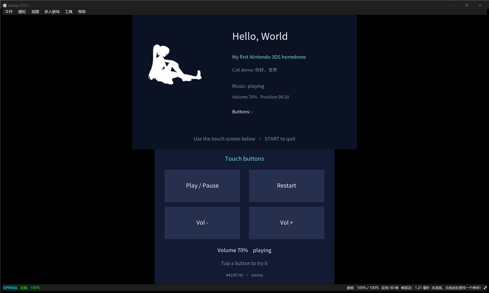

# hello-3ds（中文说明）

一个 Nintendo 3DS homebrew 入门示例。代码里不直观的地方都有注释。

> 本示例由 Pi Agent + DeepSeek V4 flash 协助编写。



> 源码注释是中文的。代码本身是普通 C，标识符和界面都是英文。
> 英文 README 见 [`README.md`](README.md)。

---

## 它演示了什么

| # | 功能 | 主要 API |
|---|------|----------|
| 1 | 两个屏幕上画字 | `C2D_TextBufNew` / `C2D_TextFontParse` / `C2D_DrawText` |
| 2 | 把 PNG 转成 3DS 纹理再画出来 | `tex3ds` → `.t3x` → `C2D_SpriteSheetLoad` |
| 3 | 下屏可点的触摸按钮 | `hidTouchRead` + 矩形命中判定 |
| 4 | 后台循环播放 MP3 | `minimp3` + `NDSP` 环形缓冲 + 独立线程 |
| 5 | 中文渲染 | `mkbcfnt` 字体子集打包进 romfs |

这五件事分别都是新手最容易卡住的地方，所以每一件都单独立出来，互不干扰。

---

## 环境要求

* [devkitPro](https://devkitpro.org/wiki/Getting_Started)，安装 `3ds-dev` 这一组
  （里面就有 `devkitARM`、`libctru`、`citro3d`、`citro2d`、`tex3ds`、`mkbcfnt`）。

装好后自检：

```sh
echo $DEVKITPRO           # 应该是 /opt/devkitpro（Windows 上 C:\devkitPro）
arm-none-eabi-gcc --version
```

---

## 编译

```sh
make          # 生成 hello-3ds.3dsx
make clean
```

输出文件名跟着**目录名**走，所以目录要叫 `hello-3ds`。

---

## 目录结构

```
hello-3ds/
├── source/main.c              全部代码（约 840 行，注释密集）
├── source/minimp3.h           MP3 解码器，单头文件，CC0
├── Makefile                   devkitPro 标准 3DS makefile
├── icon.png                   48x48 程序图标
├── gfx/
│   ├── logo.png               源图片
│   ├── logo.t3s               tex3ds 的转换配方
│   └── whitelist.txt          要打包进字体的字符表
├── romfs/                     这里的东西会被塞进 .3dsx
│   ├── cjk.bcfnt              中文字体子集
│   ├── gfx/logo.t3x           （自动生成）
│   └── music.mp3              背景音乐
├── fonts/
│   ├── LICENSE-OFL.txt
│   └── NotoSansSC-Regular.otf 源字体
└── tools/gen-font.ps1         重新生成字体
```

### `romfs` 是什么

`romfs` 是一套**只读文件系统，会被直接打包进 `.3dsx`**。程序里用 `romfs:/文件名` 访问，
相当于程序自带资源，不依赖 SD 卡上的任何东西。

---

## 程序是怎么跑起来的

`source/main.c` 按功能分成了 6 段，每段开头都有说明。这里是总览：

### ① 头文件（第 0 段）

C 语言里一个 `.c` 文件看不到别的文件写的东西，`#include` 就是把对方的「说明书」贴进来。
本项目用到四个：`stdio.h`（文件读写）、`stdlib.h`（`malloc`/`free`）、`string.h`（内存操作）、
以及最重要的 `3ds.h`（系统库 libctru）和 `citro2d.h`（2D 绘制）。

`minimp3.h` 比较特殊：它是「单头文件库」，默认只贴声明，要真正把实现编译进来必须先
`#define MINIMP3_IMPLEMENTATION`，所以那两行的顺序不能反。

### ② 全局变量（第 1、2 段）

字体、屏幕、音频状态这些东西要在好几个函数里用到，一路传参很啰嗦，所以放在文件顶层。
都加了 `static`，让名字只在本文件可见。

音频部分那些标志位（`s_quit`、`s_playing`）必须加 `volatile` —— 告诉编译器
「这个值随时可能被另一个线程改，别缓存」，否则会出现「主线程改了、音频线程却永远看不到」的鬼 bug。

### ③ 音频（第 3 段，本项目最复杂的部分）

整条链路：

```
romfs:/music.mp3
     │  fopen / fread（开机时一次性读进内存）
     ▼
内存里的 MP3 数据
     │  mp3dec_decode_frame()   ← 在【音频线程】里循环做
     ▼
PCM 数据（16 位有符号整数，左右声道交错）
     │  写进 s_waveBufs[i]，再 ndspChnWaveBufAdd()
     ▼
NDSP 声道 0  ──►  DSP 硬件  ──►  扬声器
```

**为什么要开线程？** DSP 每大约 4.9 毫秒就要一块新数据。如果解码挤在主线程里，
主线程一忙（比如在渲染画面）声音就断。分线程之后：主线程只管画，音频线程只管喂数据。

**为什么要 4 块缓冲轮着用？** 这就是所有音频系统里的「环形缓冲」，
ASIO 也是同一套思路。每块 120 毫秒 × 4 = 480 毫秒的预读深度，
DSP 播第 1 块时 CPU 去填第 2 块。深度越大越不怕卡顿，但响应也会越迟钝。

**`LightEvent` 是干嘛的？** 3DS 是*协作式*多任务：线程不会被打断，必须自己主动让出。
音频线程干完活就 `LightEvent_Wait()` 睡下，DSP 播完一块时系统调用回调函数，
回调里 `LightEvent_Signal()` 把它叫醒。回调里**绝对不能做耗时的事**，它跑在很紧的时间限制里。

### ④ 画字与图片（第 4 段）

citro2d 画一行字要三步：`C2D_TextFontParse` 把字符登记进文字缓存 →
`C2D_TextOptimize` 整理 → `C2D_DrawText` 真正画。包成了 `drawText()` 一个函数。

注意主循环里**每帧都要 `C2D_TextBufClear()`**。不清的话缓存会被撑爆，
之后新字形登记不进去，表现为「文字缺字」——这个坑很常见。

### ⑤ 触摸按钮（第 5 段）

一个按钮就是一个矩形加一行文字。触摸屏给的坐标就是下屏坐标（左上角为原点），
和按钮坐标是同一套，所以判定就是简单的大小比较。

只在 `hidKeysDown()`（刚按下的那一帧）响应，不然按住不放会一秒触发几十次。

### ⑥ 主循环（第 6 段）

```
读输入 → 更新状态 → 画一帧 → 重复
```

`aptMainLoop()` 每次迭代会检查系统有没有要求退出（按 Home 键、合盖等），
**这个判断绝对不能省**，否则按 Home 键会死机。

初始化的顺序是「从下往上」（gfx → C3D → C2D → romfs），
清理时就要「从上往下」一一对应。

---

## 硬件备忘

* 两个屏幕：**上屏 400×240**（每眼；开 3D 时面板输出 800×240），**下屏 320×240** 带触摸。
* CPU：ARM11 MPCore，**268 MHz**（旧 3DS）/ **804 MHz**（New 3DS）；
  架构 **ARMv6K**，浮点是标量 **VFPv2**，**没有 NEON**。
* DSP：原生采样率 **32728.5 Hz**，每帧 **160 个采样 ≈ 4.89 毫秒**，24 个声道，
  支持 PCM8 / PCM16 / ADPCM，可以用 `NDSP_INTERP_POLYPHASE` 做高质量重采样。
* 如果要写软音源，**优先用定点**：没有 NEON，所有浮点运算都是标量，很慢。

---

## 字体生成的两个硬性要求

用 `mkbcfnt -w` 生成子集时：

1. **codepoint 必须写成 C 整数写法**：`0x4F60`（十六进制要带 `0x`）或者十进制。
   只写 `4F60` 会被当成**十进制**解析，静默给你错误的字形。
2. **文件不能带 UTF-8 BOM**，否则第一个值解析失败，`mkbcfnt` 直接报 `Empty font` 退出。

`tools/gen-font.ps1` 把这件事自动化了：它先**剥掉源码注释**
（否则注释里的汉字会被算进去，字体体积暴涨），再收集所有剩下的非 ASCII 字符，
写出 `gfx/whitelist.txt`，然后调用 `mkbcfnt`。

> 选字体时注意授权：系统自带字体（SimHei、微软雅黑等）**不允许再分发**。
> Noto / 思源系列是 SIL OFL，可以用。

---

## 授权

MIT，见 [LICENSE](LICENSE)。

项目里还有两样东西有自己的条款：

- **字体**：`fonts/NotoSansSC-Regular.otf` 与 `romfs/cjk.bcfnt` 来自 **Noto Sans SC**，
  采用 **SIL OFL 1.1**。OFL **明确允许再分发**（包括字体文件本身），
  条件是许可证必须跟着字体走 —— 所以 `fonts/LICENSE-OFL.txt` 一定要一起提交。
  这份 Noto 的 OFL 没有声明 Reserved Font Name，所以**子集也可以继续叫 Noto**。
- **音乐**：`romfs/music.mp3` 是原创作品，© 2026 Jason YQXP，
  **不包含在 MIT 授权范围内**。别人 fork 时应该换成自己有权的音频。
